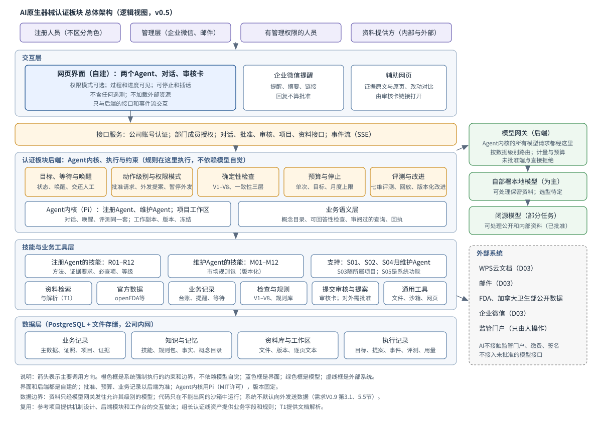

# AI原生器械认证板块总体方案

文档版本：v0.5

编制日期：2026年11月18日

文档状态：草稿；技术路线、主对话入口、工作形态、开发方式，以及角色、两个Agent、权限模式和审核方式已确定

适用对象：管理层、本项目开发人员

本文回答「怎么做」：技术路线、系统组成、模型和数据怎么接、分几步做、接下来要准备哪些文档。需求以《AI原生器械认证板块需求文档V1.0》为准，本文不重复需求内容。

依据：

- `research/调研报告_AI原生参考实现分析_v0.1`，下文简称「调研」；
- `research/验证报告_RV01-RV05_v0.3`，下文简称「验证」；
- `research/DSH主入口评估与参考项目更新分析_v0.1`，下文简称「DSH评估」。

v0.2相对v0.1的主要变化：主对话入口确定为DSH；复用已有的DSH接入代码；对话中的Agent循环由DSH负责；新增执行方案和开发交接包两项后续工作。

v0.3相对v0.2的主要变化：工作形态改为器械认证版的Claude Code（需求V0.8）。对话的Agent直接干活；能力写成技能；每个认证项目有工作区。

v0.4相对v0.3的主要变化：主对话入口由DSH改为自建的网页界面；Agent内核用Pi，在后端运行；通用工具和代码沙箱由后端提供；在本机用Codex开发，不再换设备。

v0.5相对v0.4的主要变化：登录后不区分角色（取消注册人员A、B的分工；销售和管理层不登录；系统维护改为有管理权限的人员）。单一的器械认证Agent改为两个Agent，即注册Agent（R01–R12）和维护Agent（M01–M12，以及S01、S02、S04），共用内核、工具和约束，各自有Agent定义。每个对话有权限模式：只读、请求批准（默认）、完全允许。过程由Agent完成，人审核最终结果；审核卡增加「过程中作出的判断」，取消高风险先写判断。Agent在对话中汇报进度。界面改为简洁风格，参考Codex、Claude Code、DSH。交付物明确为审核卡和项目工作区中的文件改动（有时还有业务记录的改动），Word、Excel、PDF可以预览和下载。评测改为用公开的已完成项目做回放，见5.1和数据与评测方案v0.1。

## 0 结论

1. **技术路线：新建认证板块，后端加自建的网页界面。**
   - 形态：器械认证版的Claude Code。人在界面中进入项目，和注册Agent或维护Agent对话；Agent在项目工作区里直接干活。交给人的是审核卡，加上项目工作区中的文件改动（有时还有台账等业务记录的改动）。报告只是交付物的一种。人在对话中提修改意见，或在审核卡上批准。
   - 界面：自建的网页应用，按项目组织（需求3.1）。风格简洁，参考Codex、Claude Code、DSH，细节见技术方案v0.4第3章。Word、Excel、PDF可在审核卡和项目页预览并下载。界面稿按这一风格确认后再开发正式界面。
   - 后端：Agent内核（Pi 1.3，注册Agent与维护Agent共用）、执行约束（动作级别、权限模式、目标、预算、评测）、业务数据、项目工作区、技能和Agent定义的发布、通用工具和业务工具、代码沙箱、定时与唤醒、模型网关，都由新建的后端负责。
   - 安全边界：产生业务后果的动作只经业务工具，按身份、权限模式和动作级别授权；代码只在不能联网、没有凭据的沙箱中运行。三种权限模式下都一样：结果交人审核后才算完成；发往公司外部的消息逐条批准；监管提交、缴费和签署只能由人做；数据级别、密钥、出网白名单、预算和审计保持原边界。
   - 复用：参考项目提供机制设计、后端模块和工作台的交互做法；组长认证线资产提供业务字段和规则；文档解析沿用T1。
2. **主对话入口：自建的网页界面。** 2026-11-17项目负责人决定，管理层已同意，替代此前确定的DSH，理由见2.2。界面简洁，参考Codex、Claude Code、DSH。提醒走企业微信；管理层的周报和决策项经企业微信或邮件发送。
3. **模型：按评测选择，可以使用顶级闭源模型**（2026-11-17负责人同意，不再以本地模型为主）。
   - 所有模型请求都经过后端的模型网关，按数据级别路由。
   - 经OpenRouter使用；主Agent和各用途的模型通过比选确定（第5章），注册Agent和维护Agent共用这一套；评测数据见5.1。
   - 本地模型只用于处理保密资料，也作为备选。
   - 当前认证材料（含L08）不涉及需要保密的内容，可以发往闭源模型（2026-11-17项目负责人确认）；将来需要保密的资料只用本地模型。
4. **部署：本机（可连公司内网），WSL中的Docker Compose。** 组成：接口服务（含界面）、后台进程（含Agent内核和模型网关）、代码沙箱、文档解析服务、网页抓取服务、出网代理、PostgreSQL、文件存储。
5. **实施：在本机用Codex开发，代码放在GitHub私有仓库，Codex开PR、Lan审查合并。** 第一个里程碑是可运行切片：注册Agent和维护Agent在自建界面中打通后端，加上R09一致性检查和M02美国注册核查两项技能。当前进度见7.1。
6. **文档状态：** 技术方案v0.4、执行方案v0.4与本文配套；评测数据见《数据与评测方案v0.1》（5.1）。仓库已在本机开发，进度见7.1。

L08 FY2027 FDA年度注册的截止日是2026-12-31，系统在那之前不会投入使用，需要注册人员按现有方式完成（需求D12）。

## 1 目标与约束

| 约束 | 内容 | 对方案的影响 |
|---|---|---|
| 形态 | 器械认证版的Claude Code：人与注册Agent或维护Agent对话，Agent直接干活；人审核最终结果（审核卡和项目工作区中的文件改动，有时还有业务记录的改动），并可在对话中提修改意见 | 两个Agent共用后端内核；能力写成技能；每个项目一个工作区；后端负责约束和数据 |
| 主入口 | 自建的网页界面（项目负责人2026-11-17决定，替代此前的DSH）；简洁，参考Codex、Claude Code、DSH | 按器械认证的工作方式设计，先出界面稿确认；细节见技术方案v0.4第3章 |
| 角色 | 登录的都是注册部门的成员，不区分角色；每个项目和维护事项有一位负责人；销售和管理层不登录 | 界面只显示人名；销售的请求由注册人员代提；管理层经企业微信或邮件接收周报和决策项；系统维护是管理权限 |
| 分工 | 过程由Agent完成，人负责目标和最终结果；每个对话可选权限模式，默认请求批准 | 判断在过程中由Agent作出并写入审核卡；发往公司外部的仍逐条批准；安全边界在三种模式下相同 |
| 数据 | 资料分公开、内部、保密三级；当前认证材料为内部级别，可以发往已批准的外部模型；保密资料只用本地模型 | 模型网关按数据级别路由；不默认向外发送数据；内网部署 |
| 质量体系 | AI及其工具要按风险验证（需求NF09）。申报资料或法规判断是否由第二人复核，待质量负责人确认（D22） | 代码小而清楚，全部自有；第三方组件（如Pi）固定版本，升级前回归。确认需要第二人复核时，再加为可配置的规则 |
| 团队与开发方式 | 开发人员少，在本机借助Codex开发 | 文档和任务要拆到AI能独立完成、人能审查的粒度 |
| 时间 | CPAP 510(k)计划约2027年中提交（D08）；12周试点 | 第一期能力需在2027年第一季度可用 |
| 模型 | 可以使用顶级闭源模型；本地模型只用于保密资料和备选 | 按评测选择模型；模型可替换，验收后启用 |
| 决策 | 项目由Lan全权负责（2026-11-17管理层确认） | 项目内的待决事项由Lan确认；涉及业务判断的请注册人员参与 |

## 2 技术路线

### 2.1 路线的演变

v0.1评估了三条路线：以参考项目为底座（A）、复用组长后端（B）、新建（C），建议C，理由是参考项目的核心绑定在CRM对象上，代码规模大且以葡萄牙语为主，而我们需要的是它的机制。详见总体方案v0.1第2章。

管理层确定DSH作为主入口后，路线C的后端部分不变，前台由「自建对话页面」改为「DSH插件」（v0.2）。

2026-11-17项目负责人说明公司要的是类似Claude Code、Codex的业务Agent，v0.3据此改为让Agent直接干活，后端负责约束、数据和工具。同日进一步比较「自建界面」和「复用DSH并改名换标」后，决定自建（v0.4），理由见2.2。

### 2.2 前台：自建的网页界面

选择自建，不复用DSH，理由：

1. **用户是注册人员，不是开发者。** DSH是编程Agent的工作环境，界面围绕工作区文件、终端、斜杠命令、模型和插件设置。我们最核心的界面，包括项目入口、审核卡、证据原文、改动对比和文件预览，在DSH里只能放进插槽，或跳到另外的网页。自建可以按器械认证的工作方式设计（需求3.1「界面的组织」）。
2. **不确定性小。** 用DSH要在开发中核对6项DSH行为（技能提供方、MCP经网关、唤醒触发、无头运行加载插件、进程沙箱、审核卡按钮），任何一项不符都要返工；DSH本身是331个预览版包，官方说明未做安全审计。自建只依赖Pi（MIT许可），RV-02已用千问验证过它的Agent循环。
3. **要紧的东西本来就在后端。** 约束、工具、技能、Agent定义、工作区、审批、模型网关都在后端，DSH只剩对话界面和Agent循环。这两部分参考项目已经用Pi加自建工作台做过（Next.js、React），可以借鉴。
4. **部署和验证更简单。** 不再需要每人一个DSH容器、网关挂Docker套接字创建容器、工作区在容器和后端之间同步；质量体系的软件验证（NF09）面对的是自有的小代码库。

代价：DSH现成的部分（流式对话、工具调用的折叠显示、中断、会话保存、上下文压缩、子Agent、文件工具、代码执行沙箱、计划与待办）要自己做，切片的PR数大致不变；界面要先出一版静态稿确认，避免返工。品牌不是理由：DSH是MIT许可，改名换标是可行的。

界面的组织见需求3.1：左栏按项目组织（待我处理、注册项目、维护事项、新对话），中间是对话，右栏按需展开审核卡、改动对比、证据和计划。界面简洁，参考Codex、Claude Code和DSH的布局和交互，视觉上安静、克制；只参考这些做法，不复制它们的标志、图标、配色和代码。颜色、字号和布局的细节见技术方案v0.4第3章。项目中的对话使用该项目类型对应的Agent，只有「新对话」可以选择Agent，默认注册Agent；每个对话可以选择权限模式（只读、请求批准、完全允许），默认请求批准。Agent在对话中汇报进度。审核卡和项目页的「文件」中可以直接预览Word、Excel、PDF的版面，并下载。界面稿按这一风格重做并确认后，再开发正式界面。

### 2.3 复用什么

| 来源 | 用于 |
|---|---|
| 参考项目（新版，Pi 1.3.0） | Agent内核的用法；审批与续跑、目标状态与唤醒、评测、子Agent意见冲突、业务语义层、事实有效期与修订、外发暂停等机制的设计；可移植的后端模块；对话优先工作台的交互做法；AI驱动的验证技能的做法。保留MIT版权声明 |
| 组长认证线资产 | 主表字段、清洗规则、申报清单模板、评测用例 |
| T1解析流水线 | PDF文字层、扫描页识别、Word、Excel、eSTAR加密表单的解析 |
| 验证脚本 | RV-02的Agent循环和检查作为Agent内核的回归用例；RV-05的一致性检查规则作为规则库的种子 |
| 已有DSH接入代码 | 不再复用；其中的幂等键、来源核对等做法可以参考 |

组长仓库中的工坊业务页面不复用：管理层否决的正是这种系统形态。

### 2.4 后端：新建

后端按需求V1.0实现Agent内核、执行约束、业务数据、项目工作区、业务语义层、通用工具和业务工具、代码沙箱、技能和Agent定义的发布、定时与唤醒、模型网关，并托管界面。29项能力写成技能，由AI起草、注册人员审阅，大部分是内容工作，不是代码。技能分属两个Agent，见3.1。

### 2.5 Agent循环怎么分工

| 场景 | 由谁执行 |
|---|---|
| 人在界面中对话 | 后台进程中的Agent内核（Pi）。注册项目用注册Agent，维护事项用维护Agent。Agent直接干活：用通用工具在工作副本中整理、计算、起草，用业务工具读写业务数据、运行检查、提交审核、发起对外动作；哪些动作先请人批准，由该对话的权限模式决定；过程经事件流实时显示，并在对话中汇报进度 |
| 唤醒后的继续（资料到达、来函、定时核查、人的决定） | 后端产生唤醒事件，在该项目下新开对话，按项目类型选择Agent，以负责人的身份运行；结果以审核卡交人处理，发往公司外部的生成外发提案 |
| 评测回归 | 同一个Agent内核以无界面方式运行该Agent的评测集 |

只有一套Agent循环，工具约束和模型网关都在后端，三种场景行为一致。注册Agent和维护Agent共用这套循环，差别在各自的Agent定义（见3.1）。

### 2.6 角色、分工和权限模式

登录本平台的都是注册部门的成员，登录后不区分角色。每个人都可以发起和处理注册项目与维护事项，都可以审核两个Agent的结果。界面上只显示人名。每个注册项目和维护事项有一位负责人：接收提醒，事项出现在他的「待我处理」中；负责人可以更换，其他成员同样可以查看和审核。销售人员和管理层不登录。销售的合规报告、证照资料包、UPC请求，由注册人员在对话中代为提出。管理层的周报和决策项由维护Agent准备，经企业微信或邮件发送（S04）；管理层的决定由注册人员记录到对应的项目中。系统维护（用户、模型配置、预算、任务监控）是个别人员的管理权限；有这项权限的人在设置中看到维护页。资料提供方不登录，接收Agent的资料请求和催办。

人负责目标和最终结果。分类与路径、对比器械、法规适用性、变更是否需申报、发补答复立场等判断，在过程中由Agent作出，写明理由、备选方案和依据，并在审核卡的「过程中作出的判断」中逐条列出。人不同意时在对话中说明，Agent修改后重新提交。仍由人决定的是：风险接受，超出预算的费用，向监管机构或客户发出正式文件前的最终确认，以及需要管理层决定的路径、重大风险、大额费用和关键商业结论。资料中没有的事实不猜测；证据冲突时停止写入并问人。判断可以由Agent作出，事实不能编造。首版所有能力的最终结果都交人审核；抽查后直接生效留待以后，按评测和试用数据再开放。

过程中的批准用批准请求，发往公司外部的用外发提案，最终结果用审核卡。每个对话有一个权限模式，在输入框旁选择，可以随时切换，从下一次工具调用起生效。新对话默认「请求批准」。

| 模式 | Agent直接做的 | 先请人批准的 |
|---|---|---|
| 只读 | 读资料和记录、检索、运行检查、计算、回答问题 | 不做任何写入，工作副本也不能写 |
| 请求批准（默认） | 只读模式下的全部；在本对话的工作副本中写、改文件；在沙箱中运行代码；启动子Agent；维护计划；保存工作区版本；把附件和产出导入资料库 | 写业务记录；给内部同事发消息；作关键判断前先提出建议，等人确认 |
| 完全允许 | 请求批准模式下直接做的全部，加上写业务记录、给公司内部同事发消息，以及作出关键判断并写明依据后继续 | 中途不需要批准，最后把结果交人审核 |

批准请求出现在输入框上方，写明要做什么、改哪条记录或消息的收件人和内容；人可以选择允许、本对话中都允许，或拒绝并写原因。完全允许模式下直接发给公司内部同事的消息，收件人须是已登记并绑定身份的同事，发送前仍检查事项是否已取消、外发是否已暂停、附件的数据级别是否允许。

任何模式下都同样遵守：

1. 结果交人审核。交付物以审核卡提交，人通过后才算完成；定稿冻结只在人批准后发生。
2. 发往公司外部的消息逐条经外发提案批准，进入外发队列，发送前再检查。
3. 监管门户提交、缴费、签署，以及向监管机构或客户发正式文件，只由人完成。不可逆动作始终拒绝。
4. 数据级别路由、密钥、沙箱不联网、出网白名单、预算上限、审计记录和撤销保持原边界。权限模式只决定过程中问不问人。
5. 批准在浏览器界面中点击才生效。在对话或企业微信中说「同意」不算批准。批准请求由发起该对话的人处理。

Agent交给人的是审核卡，加上项目工作区中的文件改动，有时还有台账等业务记录的改动。报告只是交付物的一种。文件是可以直接使用的工作成果，包括按公司模板生成的Word、Excel、PDF，装配好的申报包，eSTAR填报单和预填表单。审核卡和项目页的「文件」中可以直接预览Word、Excel、PDF的版面，并下载。

审核卡分八部分：结论、需要你做什么、过程中作出的判断、改动、关键依据、AI自检、不确定事项、操作。Agent开始一项工作时列出步骤，每完成一步在对话中用一句话说明进度；运行中，输入框上方显示当前状态。人不在线时，进度同样写入对话；只有需要人处理的事和最终结果才推送通知，其余合并进日摘要。

## 3 总体架构

### 3.1 组成

| 部分 | 职责 | 来源 |
|---|---|---|
| 网页界面 | 按项目组织的对话界面：项目栏、对话（过程可展开、可停止和插话，并显示进度）、权限模式与批准请求、审核卡、改动对比、文件预览与下载、证据原文与原页、计划与待办、上传、维护页（有管理权限的人员在设置中进入） | 新建；交互做法借鉴参考项目的工作台 |
| 接口服务 | 公司账号认证；登录用户都是注册人员，业务权限相同，系统维护另有管理权限；对话、批准请求、审核、项目、工作区、资料接口；事件流（SSE）；托管界面 | 新建 |
| Agent内核 | 注册Agent与维护Agent的运行：共用Pi 1.3的Agent循环、同一套工具和约束、上下文组装与压缩、子Agent、插话与中断；各自有Agent定义（系统提示词、技能索引和评测集）；对话、唤醒、评测共用 | 新建，Pi的用法参照参考项目新版 |
| 工具 | 通用工具（工作区文件、代码执行、网页、子Agent、计划、技能、提问）和业务工具（资料、官方数据、业务记录、检查与规则、提醒与等待、提交审核、外发提案）；按动作级别和权限模式执行 | 新建；解析用T1 |
| 代码沙箱 | 运行Agent交来的代码；不能联网、没有凭据 | 新建 |
| 企业微信提醒 | 提醒、摘要、链接 | 新建，参照参考项目飞书模块的结构（验证RV-04） |
| 执行与约束 | 目标、等待与唤醒、动作级别、权限模式与批准请求、外发提案与外发暂停、确定性检查、预算、评测与改进 | 新建，按参考项目机制实现 |
| 项目工作区 | 每个项目的资料引用、草稿、清单、计划、决定记录；每个对话的工作副本；版本、改动对比、定稿冻结 | 新建 |
| 业务语义层 | 概念目录、可回答性检查、审阅过的查询、回执 | 新建，参照参考项目新版的设计 |
| 技能与规则包 | 29项能力各一份技能：方法、证据要求、必查项、交付格式；各市场规则包。注册Agent与维护Agent各有一份技能索引 | 内容工作：AI起草、注册人员审阅；业务规则取自需求V1.0第4章和附录A |
| 模型网关 | 所有模型请求的入口：按数据级别路由、计量、预算、拒绝未批准端点 | 新建，参照参考项目的模型网关 |
| 数据 | 业务记录、对话、知识与记忆、资料库、工作区、执行记录 | PostgreSQL和文件存储；字段以组长主表为基础 |

两个Agent共用同一个内核、同一套工具和约束、同一套预算和计量、同一个资料库和项目工作区机制，各自有一份Agent定义：系统提示词、技能索引和评测集。注册Agent负责注册项目，技能为R01–R12。维护Agent负责维护事项，技能为M01–M12，以及S01合规报告与证照资料包、S02 UPC、S04周报与管理层决策项。S03沟通与会议归档由所属项目的Agent处理。S05 AI工作质量保障是系统功能，不属于某个Agent。注册项目下的对话用注册Agent，维护事项下的对话用维护Agent；人发起的「新对话」可以选择，默认注册Agent。唤醒时按目标所属项目的类型选择Agent。两个Agent都可以读取台账回答问题。R12获证后，注册Agent建立对应的维护事项并附移交清单（按当前对话的权限模式执行），之后由维护Agent负责。以后增加角色Agent时，按同样方式增加Agent定义。

### 3.2 一项任务怎么跑

以「检查L08申报包」为例：

1. 注册人员在界面中进入L08项目，对注册Agent说「检查L08申报包」。这是注册项目，对话使用注册Agent；权限模式为「请求批准」（新对话的默认模式）。
2. Agent读项目说明，加载R09技能，列出步骤。
3. Agent按技能工作，每完成一步在对话中说明做到了哪一步；过程可以展开查看：
   - 用规则工具跑标准检查项；
   - 按资料类别启动子Agent抽取字段；
   - 比对陈述，逐条复判候选差异；请求批准模式下，作出关键判断前先提出建议，等人确认；
   - 用检查工具运行V1、V2、V7；
   - 在工作副本中写出差异清单，保存为工作区的新版本。
4. Agent提交审核：后端运行技能要求的检查和评测，生成审核卡，显示在右栏。审核卡包括结论、需要你做什么、过程中作出的判断、改动、关键依据、AI自检、不确定事项和操作；改动指向项目工作区中的文件（有时还有台账等业务记录），依据链接到证据查看页。Word、Excel、PDF可以在审核卡和项目页的「文件」中预览版面并下载。
5. 注册人员在对话中说「第3条按笔误处理，第7条不算」，Agent修改后重新提交，新审核卡只显示这两处改动。
6. 注册人员在审核卡上点「通过」，结果定稿。需要外发的，Agent生成外发提案，程序校验收件人后交注册人员批准，发送前再检查一次。

## 4 关键技术选择

以下是总体方案层面的选择，细节在技术方案中确定。

| 方面 | 选择 | 理由 |
|---|---|---|
| 界面 | 自建：React 19、Vite、TypeScript、Tailwind CSS、Radix UI，由接口服务托管 | 按器械认证的工作方式设计，风格见2.2；与参考项目的工作台技术栈一致，便于借鉴 |
| Agent循环 | Pi 1.3，在后台进程中运行；对话、唤醒、评测共用；注册Agent与维护Agent共用这一套循环 | RV-02已验证；只维护一套循环，两份Agent定义 |
| 工具 | 通用工具和业务工具都在后端；代码只在沙箱中运行 | 能力齐全，边界清楚 |
| 能力的实现 | 技能（Markdown加附件），后端版本化发布；两个Agent各有技能索引 | 能力的工作变成可审阅的内容；步骤由Agent规划 |
| 实时显示 | 对话事件写库后经SSE推给浏览器，断线可续读 | 流式显示过程；刷新不丢状态 |
| 后端语言 | TypeScript（Node.js 24）；文档解析、沙箱、网页抓取用Python | 与参考项目一致；T1已用Python验证 |
| 数据库 | PostgreSQL 16（语义检索用向量扩展） | 不需要Supabase |
| 任务队列与定时器 | 基于数据库的任务表（pg-boss），带执行权期限 | 参考项目的做法，少一个依赖 |
| 文件存储 | MinIO，按内容哈希管理版本 | 满足工作区版本、申报快照和版本比对 |
| 用户与权限 | 公司账号由接口服务认证；登录用户都是注册人员，业务权限相同，系统维护是管理权限；后端按用户身份、权限模式、目标状态、动作级别和对象授权 | 一处认证、一处授权。数据级别、密钥和沙箱边界在三种权限模式下相同 |
| 部署 | 本机WSL中的Docker Compose | 开发和最终部署在同一台电脑上 |

## 5 模型策略

| 用途 | 模型 | 说明 |
|---|---|---|
| 主Agent、子Agent | 比选选出的模型，可以是顶级闭源模型，经OpenRouter使用 | 注册Agent和维护Agent共用。候选包括千问和顶级闭源模型，按技能评测得分和费用确定（PR-29第一轮、PR-37正式） |
| 字段抽取等简单任务 | 便宜的模型，如千问3.8 Flash | 千问3.8 Flash和千问4 Max都通过了工具调用与策略验收（验证RV-02） |
| 保密资料（将来） | 只用本地模型 | 需求V1.0第5.5节；本地模型按需部署，用同一套评测验收 |
| 复核 | 与执行模型不同家族的模型 | 需求V1.0的V5 |
| 文字识别 | 本地RapidOCR | T1已验证，不经过大模型 |

界面中没有模型选择；所有模型请求经后端的模型网关。

**主Agent的模型通过比选确定**（2026-11-17项目负责人决定）：Agent内核跑通后先做第一轮比选，候选包括千问3.8 Flash、千问4 Max和一到两个顶级闭源模型，确定开发期默认的主Agent模型；R09、M02的技能评测完成后做正式比选，按得分和费用确定各用途的模型。简单任务（字段抽取等）用便宜的模型。本地模型不再是必须替换的目标，只在需要处理保密资料、或为降低费用时引入，同样要通过评测。费用上限见D13。注册Agent和维护Agent使用同一套主Agent模型，各自的差别写在Agent定义里（系统提示词、技能索引和评测集）。

Claude Code形态的开放式工作对模型能力的要求，比按固定流程逐步调用更高：模型要自己规划步骤、长时间连续使用工具。因此模型验收要包括技能评测，主Agent用评测得分高、费用可以接受的模型；技能中的步骤也要写得具体。评测用的数据见5.1。

### 5.1 评测与磨合的数据

公司每年的认证项目不多，一个项目要几个月，不能只靠陪跑来磨合。评测用公开的已完成项目做回放：遮住答案，让Agent重做关键步骤，再与真实记录比对。数据分四层：公司自己已完成的项目、公开的同类已完成项目、公开的规则和参考数据、合成场景；进行中的真实工作仍按V1做影子运行。要防两件事：背题，测试集用模型训练截止之后获批或签发的项目；偷看答案，回放时遮挡身份，并把官方数据的查询截断在回放日期之前。

2026-11-18查询公开数据的结果：美国LRK、LQZ、BZD、BTT四个产品代码自2016年以来约220个510(k)，几乎都有公开摘要。公司侧列入回放的美国已获批项目有L08（资料已有）、L07（K251628）、L09（K262104）和JoyMask 20-B（K251920）；L07和JoyMask 20-B的申请人是Dcstar，是否为公司项目待业务确认（需求D04）。加拿大方面，深圳三一先锋（MDALL公司编号184937）名下有21张有效的II类MDL。V1前的第一批规模：美国公开回放约220例，加拿大同类许可约170张，公司项目回放列入上述4个510(k)和21张MDL（Dcstar名下的两件待确认），另有维护事件回放、注入缺陷约50例、合成场景约50例，加上影子运行。注册Agent和维护Agent各自使用其中与自己能力对应的题目。

题目设计、判分和做法见《AI原生器械认证板块数据与评测方案v0.1》（`data_plan_v0.1/`）。该方案是草稿，2026-11-19与业务人员对接后修订。出网白名单是否加入这些公开数据源见D23；建库脚本在开发机上运行，不受白名单限制。

## 6 数据接入与部署

### 6.1 数据接入

| 来源 | 方式 | 状态 |
|---|---|---|
| WPS云文档 | 接口或导出同步 | 接口能力待确认（D03） |
| 邮件 | 来函、回执的读取 | 是否接入待定（D03） |
| 官方公开数据 | openFDA、FDA网站、联邦公报、加拿大卫生部 | 需要服务器出网白名单；摘要和加拿大、欧盟等公开页面是否放行见D23 |
| 企业微信 | 发送提醒；接收回复需要回调地址和可信IP | 需IT确认（D03） |
| 现有Excel台账 | 按组长清洗规则首次导入 | 待注册人员提供（D05） |
| 申报资料 | 上传或从WPS同步，入库时解析 | T1已验证 |

### 6.2 部署

- **应用服务器**：本机（可连公司内网），在WSL的Docker中运行接口服务、后台进程、代码沙箱、解析服务、网页抓取服务、出网代理、数据库、文件存储。不再为每个用户启动容器，资源在切片部署时实测。
- **本地模型**：部署在Mac Studio上，经内网访问。
- **网络**：只有接口服务对用户开放；后端只允许访问出网白名单中的地址（官方数据源、经批准的闭源模型接口）；代码沙箱没有出口。公开数据源是否加入白名单见D23。建库脚本在开发机上运行，不受此限。

## 7 实施计划

### 7.1 阶段

| 阶段 | 内容 | 时间（初步估计） |
|---|---|---|
| 准备 | 技术方案、执行方案与PR拆分、本机仓库初始化 | 已完成（2026-11-17） |
| 第0阶段：可运行切片 | 见7.2；界面稿按2.2的风格重做并确认后再开发正式界面。切片是内部里程碑 | 约4–5周 |
| 首个可用版本（V1） | 见7.3；注册人员从V1开始影子运行 | 切片后约5周 |
| 第一期其余部分 | 需求第9章第一期的其余能力：以技能为主，补齐缺少的业务工具 | V1后约6–7周 |
| 试点 | 全景表12周试点 | 12周 |
| 第二期、第三期 | 按需求第9章 | 视试点结果 |
| 上线准备（并行） | 知识内容建设（技能、规则包、检查项、模板、概念目录、评测标注）；初始化（台账、证照、在途工作、L08案例）。见需求第9章 | 与切片和第一期并行，试点前完成 |

切片要自建界面和Agent内核，PR数与v0.3相当，但多了界面稿的确认，估计多出约一周。第一期的代码工作较少：每项能力主要是技能内容和评测，代码只补缺少的业务工具；时间主要取决于注册人员审阅技能和标注评测的时间（D18）。时间在切片完成后按实际速度修正。

当前进度（截至2026-11-18 16:00）：Codex已合并PR-00～PR-12、PR-14、PR-16、PR-20和需求变更的PR-C1～PR-C3，共19个PR。下一步是PR-C4，然后PR-21、PR-25、PR-26、PR-27走通主路径。详见执行方案v0.4「当前进度」。

### 7.2 可运行切片

1. **执行基础**：
   - 新仓库（本机，GitHub私有仓库）；
   - 后端的动作级别、权限模式与批准请求、目标与唤醒、项目工作区、预算、数据边界、模型网关；
   - Agent内核（Pi）、两份Agent定义（注册、维护）、通用工具与代码沙箱、技能机制；
   - 对话接口与事件流（含Agent、权限模式、批准请求和进度）；
   - 网页界面：先出可点击的界面稿（风格见2.2），确认后开发项目栏、对话（含权限模式、批准请求和进度）、八部分审核卡（含过程中作出的判断、改动对比和文件预览）、证据查看、上传；
   - Agent测试，并把验证脚本转为回归测试。
2. **R09 申报一致性检查（注册Agent的技能）**：用L08真实资料，开发阶段的模型用OpenRouter；包括「提修改意见、再次提交」的循环。
3. **M02 美国年度注册与列名核查（维护Agent的技能）**：用FDA公开数据核查企业注册、列名、美国代理人、GUDID状态，生成提醒和待办；定时唤醒能在负责人不在线时完成核查。

切片是内部里程碑：用L08资料验证平台和两项技能，可以向管理层演示，但不作为注册人员试用的版本。

### 7.3 首个可用版本（V1）

V1是注册人员开始试用的版本，要做到每天都用得上，而不只是演示（需求第9章）：

1. **范围**：切片，加上M01（含现有台账导入）、台账问答、S01合规报告与证照资料包、R01、R02、R04、网页检索与抓取、改稿回收与反馈、运维监控；企业微信提醒视IT条件。注册项目的能力由注册Agent承担，维护事项和S01由维护Agent承担；S01由注册人员代销售发起。台账问答两个Agent都可以做。
2. **试用方式**：影子运行。注册人员照常工作，注册Agent或维护Agent同时处理同样的在途事项：证照与到期、合规报告请求、CPAP 510(k)的立项、路径和证据规划。两边对比，按需求8.7验收。
3. **前提**：
   - 现有台账和证照清单由注册人员提供（D05、执行方案K06）；
   - CPAP资料中的研发设计资料先确认数据级别，保密的只能用本地模型（D19）；
   - 软件验证完成前，AI的结果只作参考，正式文件和对外提交仍按现行流程由人完成（需求NF09、D20）。

V1之后，按第一期的其余能力继续，试点在第一期全部完成后开始。

## 8 风险与应对

| 风险 | 应对 |
|---|---|
| 第一个版本只有演示价值，注册人员用不上 | 切片只作内部里程碑；注册人员从V1开始试用，V1包含每天都用得上的能力，并用在途工作做影子运行（7.3） |
| 主Agent的模型能力不够，开放式工作做不好 | Agent内核跑通后立即做模型比选，候选包括顶级闭源模型；技能评测达标后才定型（第5章） |
| 「足够好」没有标准，验收时说不清 | 需求8.7列出V1的验收指标；目标值在取得基线后由注册人员和管理层确定（D20） |
| 工具和提示词的细节粗糙，Agent用起来别扭 | 技术方案4.27的设计规则作为代码审查的检查项；任何改动都跑Agent评测 |
| 代码审查都压在Lan一个人身上 | 每个PR先由AI审查一遍，Lan重点看动作级别、审批、沙箱等关键部分 |
| 自建界面的工作量和质量 | 先出界面稿确认布局和用语，风格参考Codex、Claude Code、DSH（2.2）；借鉴参考项目工作台的交互做法；用成熟的组件库；端到端测试覆盖主要路径 |
| Pi 1.3的接口与预期不符 | 按参考项目新版的用法核对；Agent循环本身不大（RV-02的实现约350行），可以在同一接口后面自己实现 |
| 沙箱隔离失效（能出网、带了凭据） | 安全检查脚本在每次部署和升级后验证；业务后果只经业务工具，按身份、权限模式和动作级别授权，不依赖沙箱 |
| 第三方依赖默认外发（统计、错误上报、外部字体） | 引入依赖时检查；界面的内容安全策略只允许本站资源；出网只经白名单代理 |
| 开放式的Agent工作对模型能力要求更高 | 技能写成明确的步骤；交付前由后端强制检查；每个技能有评测集；模型验收包括技能评测；复杂任务可以用闭源强模型 |
| 闭源模型的费用和供应（价格变化、服务中断） | 预算上限与告警（D13）；模型网关配置备用上游；评测集随时可以比较替代模型 |
| 将来的保密资料只能用本地模型，而本地模型能力不足 | 本地模型接入前用同一套评测验收；不足时这类任务降级为「AI准备、人执行」；确定性检查不依赖模型 |
| 数值和单位错误 | 业务语义层给出单位；V7检查；数值评测集 |
| 本机同时运行组长的容器，资源和端口冲突 | 端口避开已占用的清单；开发前停止验证用的Supabase；资源在切片部署时实测 |
| 质量体系验证工作量 | 第一期上线前完成软件验证计划；借鉴参考项目AI驱动验证的做法收集证据 |
| 知识内容跟不上开发：系统建好了，AI仍不能胜任工作 | 内容由AI起草、注册人员审阅；按期次分批；在执行方案中单列为内容任务，与代码PR同步排期 |
| 资料进不来、交付物做不出、外部回复收不到 | 技术方案4.18–4.20：整包导入、文档生成与eSTAR填报单、邮件往来；接入前保留人工上传的方式 |
| 需求在对接中持续变化，正文和已合并的代码不一致 | 每轮对接出一份编号的变更单；Codex在两个PR之间做变更同步；变更定期并入需求、总体方案、技术方案和执行方案的正文。2026-11-18的需求变更单已并入本文，原单保留在 `change_requests/` 作为变更记录 |

## 9 开发用的文档

### 9.1 技术方案

当前版本：`technical_design_v0.4/`。它是开发的依据，内容：

- 模块划分和代码仓库结构；
- 界面：布局、对话视图、审核卡、权限模式、批准请求、进度、文件预览、事件流、界面安全、界面稿；
- 后端接口和数据模型；
- Agent内核、通用工具与代码沙箱、两份Agent定义与技能、项目工作区；
- 执行层设计：工具登记与动作级别、权限模式与批准请求、提案与外发、外发暂停、目标、等待与唤醒、预算、评测；
- 业务语义层：首版概念目录和查询模板；
- 模型网关；
- 部署配置、开发环境与资源估算；
- 安全设计；
- 架构图：部署图，以及一次工作、审批的流程图。

### 9.2 执行方案（拆成PR）

当前版本：`execution_plan_v0.4/`。开发在本机由Codex完成，任务拆到AI能独立完成、人能逐个审查的粒度，每个PR写清：

| 项 | 内容 |
|---|---|
| 目标 | 这个PR完成什么 |
| 范围 | 涉及的模块和文件；明确不做什么 |
| 依赖 | 必须先合并的PR |
| 交付 | 代码、测试、文档更新 |
| 验收 | 运行哪些命令、期望什么结果；对应需求的哪几条 |

按里程碑分组：仓库与基础设施 → 后端核心 → 模型网关与检查 → 文档解析与资料 → Agent内核与界面 → R09 → M02 → 评测与切片验收 → 第一期。

需求变更的PR-C1～PR-C4插在Agent内核之后。主路径的当前进度见7.1，细节见执行方案v0.4「当前进度」。

给Codex的开发约定放在新仓库的 `AGENTS.md` 中，包括：不能破坏的设计、Agent运行环境检查清单、数据与密钥、测试要求、Windows开发注意事项、中文文档、引用核对、什么时候停下来问。

### 9.3 仓库与参考资料

开发在本机进行，不再需要交接包：

- 新仓库在本机初始化，第一次提交包括 `AGENTS.md`、文档、文档生成工具和L08派生的小型测试资料；
- 参考资料（参考项目新版源码、T1代码、验证脚本、组长认证线资产）和L08原始资料，由 `tools/build_handoff.py --ref-only` 整理成一份只读的参考资料快照，新仓库用环境变量指向它；
- 任何密钥和 `.env*` 文件都不进仓库和快照；OpenRouter key只放在新仓库的 `.env.local` 中。

### 9.4 其他

| 事项 | 时间 |
|---|---|
| 评测集补全：注册人员标注V0.4的E04、E05、E10、E11、E14；确认L08两条新发现；编写数值单位、CPAP示例、交互用例 | 与切片并行 |
| 公开数据回放的第一批（数据与评测方案v0.1第9章） | 与模型比选和V1并行准备 |
| 界面稿的确认（按2.2的风格重做之后） | 正式界面开发之前 |
| 软件验证计划（需求NF09） | 第一期上线前 |
| 知识内容建设与初始化（需求第9章上线准备） | 与切片和第一期并行，试点前完成 |

## 10 待决事项

| 编号 | 事项 | 需要在何时决定 | 建议确认人 |
|---|---|---|---|
| D02 | 各用途的模型（比选确定，可以是顶级闭源模型）；需要处理保密资料时本地模型的选型和部署 | PR-29、PR-37；本地模型在出现保密资料时 | Lan；本地模型由部署同事配合 |
| D03 | WPS、邮件、企业微信的接入条件 | 第一期开始前；企业微信回调可后补 | 技术负责人、IT |
| D13 | 模型费用：比选和开发期的上限；月度上限和告警阈值 | 比选前；V1影子运行前 | Lan |
| D11 | 组长认证线资产（字段、规则、模板、评测用例）的复用方式 | 已按参考资料使用；如需组长确认，切片开始时 | Lan、组长 |
| 新增 | 内网访问地址和出网白名单（公开数据源见D23） | 切片试用前 | IT |
| D16 | 访问方式：只在内网，还是允许外出时经VPN或企业微信审核 | 第一期上线前 | Lan、IT |
| D17 | 已购ISO、IEC等标准的副本能否入库供AI使用 | 第一期R04、R05开始前 | 注册人员、质量负责人 |
| D18 | 知识内容建设的分工与时间 | 切片开始时 | 注册人员，Lan |
| D19 | CPAP资料的数据级别：研发设计资料是否属于保密 | V1影子运行开始前 | 注册人员、研发负责人、Lan |
| D20 | V1验收标准的目标值；软件验证完成前AI结果只作参考的规则 | V1验收前 | 目标值：Lan、注册人员；使用规则：质量负责人确认 |
| D21 | 公司统一登录的接入方式（如企业微信登录） | 试点前；V1先用管理员建立的账号 | IT、Lan |
| D22 | 质量体系是否要求申报资料或法规判断由第二人复核；需要时，加为可配置的规则 | 不阻塞当前开发；确认需要后再加入 | 质量负责人 |
| D23 | 出网白名单是否加入公开数据源：www.accessdata.fda.gov、health-products.canada.ca、recalls-rappels.canada.ca、laws-lois.justice.gc.ca、ec.europa.eu。建库脚本在开发机上运行，不受此限 | Agent在运行中需要查询这些数据源之前 | Lan |

已决定：D15（新建认证板块，路线C）；2026-11-17：形态为器械认证版的Claude Code；主对话入口改为自建的网页界面（D01，管理层已同意，替代此前确定的DSH）；在本机用Codex开发，代码放GitHub私有仓库，Codex开PR、Lan审查合并；首个可用版本（V1）包含日常就能用的能力，用在途工作做影子运行；主Agent的模型通过比选确定，可以使用顶级闭源模型，不再以本地模型为主（负责人同意）；项目由Lan全权负责，项目内的待决事项由Lan确认。2026-11-18：登录后不区分角色，销售和管理层不登录，系统维护是管理权限；首版分为注册Agent和维护Agent；权限模式为只读、请求批准（默认）、完全允许；过程由Agent完成，人审核最终结果；界面按Codex、Claude Code、DSH的简洁风格；交付物为审核卡和项目工作区中的文件改动（有时还有业务记录的改动），Word、Excel、PDF可预览和下载；建库脚本在开发机上运行，不受出网白名单限制。上述内容已并入本文，变更单保留在 `change_requests/需求变更单_2026-11-18.md` 作为变更记录。

## 修订记录

| 版本 | 日期 | 内容 | 状态 |
|---|---|---|---|
| v0.1 | 2026-11-17 | 首版：路线评估与建议、总体架构、关键技术选择、模型策略、数据接入与部署、实施计划、风险、后续文档 | 已被替代 |
| v0.2 | 2026-11-17 | 主入口确定为DSH；复用已有DSH接入代码；Agent循环分工；模型以自部署本地模型为主；新增执行方案和开发交接包。同日补充：开发阶段用OpenRouter和L08真实资料；交接包可以包含L08资料；新增并行的上线准备（知识内容建设、初始化）、两项风险和D16–D18 | 已被替代 |
| v0.3 | 2026-11-17 | 形态改为器械认证版的Claude Code：对话的Agent直接干活；只用DSH一套Agent循环（对话、唤醒、评测）；能力写成技能；新增项目工作区；DSH自带工具在隔离容器中全部可用；业务工具做成MCP服务；更新架构图、切片内容和风险 | 已被替代 |
| v0.4 | 2026-11-17 | 主对话入口改为自建的网页界面（2.2说明理由）；Agent内核用Pi，在后端运行，对话、唤醒、评测共用；通用工具和代码沙箱由后端提供；在本机用Codex开发，GitHub私有仓库；不再需要交接包；更新架构图、组成、技术选择、切片内容、风险和待决事项。同日补充：首个可用版本（V1）与影子运行（7.3）；主Agent模型比选（第5章）；新增五项风险和D19–D21；可以使用顶级闭源模型，本地模型只用于保密资料和备选；管理层同意不用DSH；项目由Lan全权负责 | 已被替代 |
| v0.5 | 2026-11-18 | 并入需求变更单：不区分角色，取消注册人员A、B；销售和管理层不登录；系统维护改为管理权限（原技术维护人员）。器械认证Agent改为注册Agent和维护Agent。增加三种权限模式。过程由Agent完成，人审核最终结果，取消高风险先写判断；Agent汇报进度。界面参考Codex、Claude Code、DSH。补充交付物形式与文件预览、评测与磨合的数据（5.1）、当前进度、D22、D23，以及需求持续变化的风险。需求依据改为V1.0；技术方案、执行方案改为v0.4 | 草稿 |
